# Introduction to Node.js and Core Concepts

## Overview

This lecture provides a foundational overview of Node.js, explaining its architectural roots, how JavaScript traditionally operates in web browsers via engines like V8, and how creator Ryan Dahl embedded Chrome's V8 engine in C++ to bring JavaScript to the backend. It includes live terminal REPL demonstrations and highlights the official definition and prerequisites for learning Node.js.

**Duration:** 07:44

## 1. Understanding JavaScript & JS Engines `[00:31 - 02:25]`

### Explanation

JavaScript was originally created as a client-side scripting language intended to make web pages interactive inside web browsers. Browsers cannot run JavaScript directly without a dedicated component called a JavaScript Engine. When users run a web browser, an embedded engine interprets and executes JavaScript scripts. Different browser vendors use different engines: Google Chrome uses the V8 engine, Mozilla Firefox uses SpiderMonkey, and Apple Safari uses JavaScriptCore. Google Chrome's V8 engine is currently the most popular and widely adopted JavaScript engine.

### Key Concepts

- JavaScript Engine
- Chrome V8 Engine
- SpiderMonkey
- JavaScriptCore
- Client-Side Execution

### Examples

- Google Chrome running the V8 engine
- Mozilla Firefox running SpiderMonkey
- Apple Safari running JavaScriptCore

### Visual Explanation

The lecture slides depict how JavaScript executes inside a web browser sandbox. A comparative diagram maps major web browsers to their respective JavaScript engines (Chrome with V8, Firefox with SpiderMonkey, and Safari with Apple's JS Engine), followed by a slide highlighting V8 as the industry standard.

### Important Visual Text

- `What is Node.JS?`
- `JS - Javascript Engine`
- `Javascript Engine - Chrome (V8), Firefox (SpiderMonkey), Safari (Apple JS Engine)`
- `Javascript Engine V8 - Most Popular Engine`

### Visuals

**Slide at 00:35**

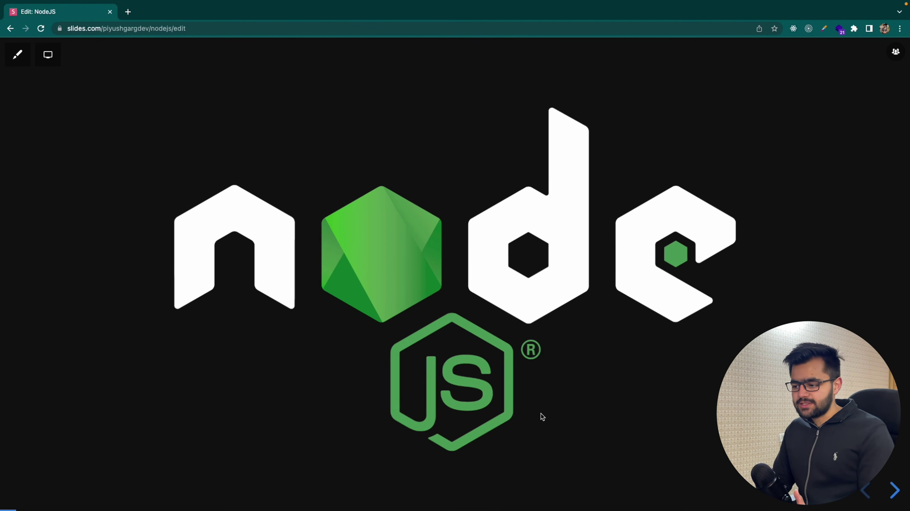

*Title slide introducing the topic 'What is Node.JS?' featuring the Node.js logo.*

**Slide at 01:05**

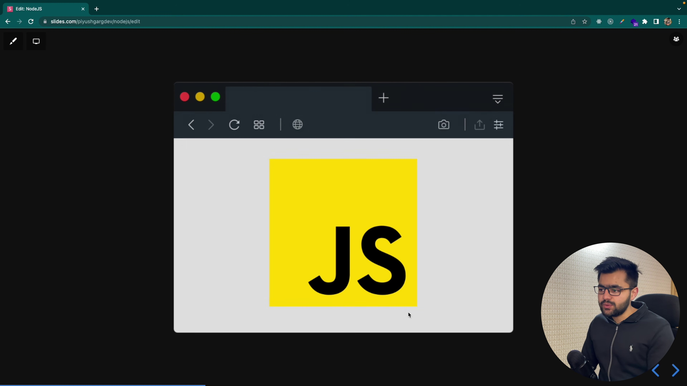

*Illustration showing JavaScript code executing inside a web browser window using an embedded JavaScript engine.*

**Diagram at 01:59**

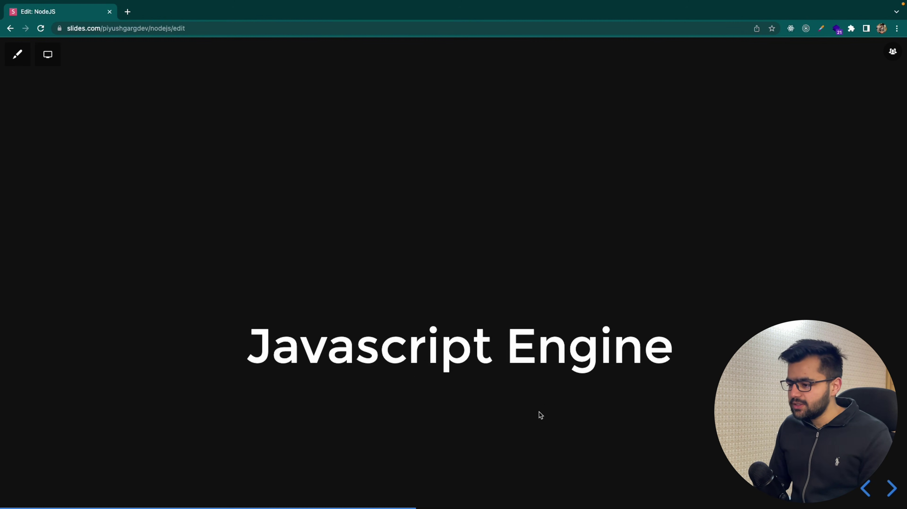

*Diagram displaying icons of major web browsers alongside their corresponding JavaScript engine logos.*

**Slide at 02:25**

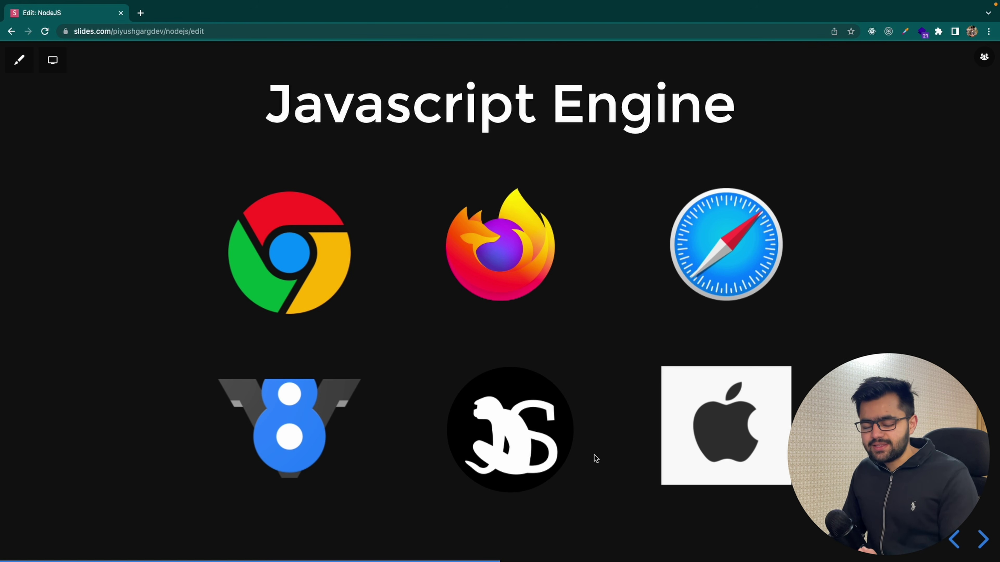

*Graphic highlighting the V8 Engine as the most popular JavaScript engine.*

### Key Takeaway

> Web browsers rely on specialized JavaScript engines—most notably Google Chrome's V8—to parse and execute client-side JavaScript code.

## 2. Creation of Node.js and Core Capabilities `[02:25 - 04:39]`

### Explanation

Developer Ryan Dahl created Node.js by taking Google Chrome's open-source V8 engine and wrapping it inside C++ code. Because C++ can directly interact with the underlying hardware and host operating system, binding V8 with C++ allowed JavaScript to run outside the browser sandbox. This architecture gives JavaScript access to native machine capabilities, such as direct filesystem handling, read/write operations, and memory management, enabling developers to build server-side applications and web servers entirely in JavaScript.

### Key Concepts

- Ryan Dahl
- V8 Engine Binding with C++
- Out-of-Browser JavaScript
- Native OS / File System Access
- Server-Side JavaScript

### Examples

- Interacting directly with the host operating system filesystem
- Building standalone web backend servers using JavaScript

### Visual Explanation

A structural flowchart illustrates Ryan Dahl combining Chrome's V8 JavaScript engine with C++ to produce Node.js. A subsequent summary slide lists key Node.js capabilities, emphasizing out-of-browser execution and server-side application development.

### Important Visual Text

- `Javascript Engine - Ryan Dahl - V8 -> C++ -> Node.js`
- `NodeJS`
- `- You can run JS outside of the browser`
- `- Javascript can talk to native machine because of c++`
- `- You can create webservers in Javascript Language`

### Visuals

**Diagram at 02:46**

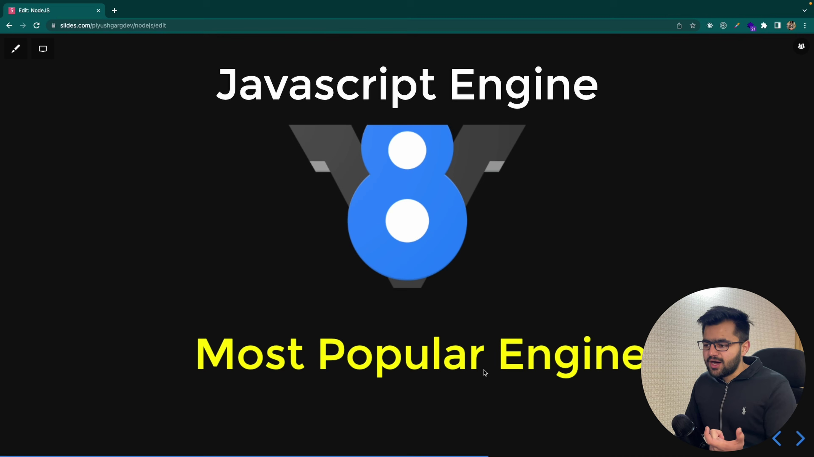

*Flowchart diagram illustrating Ryan Dahl combining Chrome's V8 engine with C++ to produce Node.js.*

**Slide at 03:35**

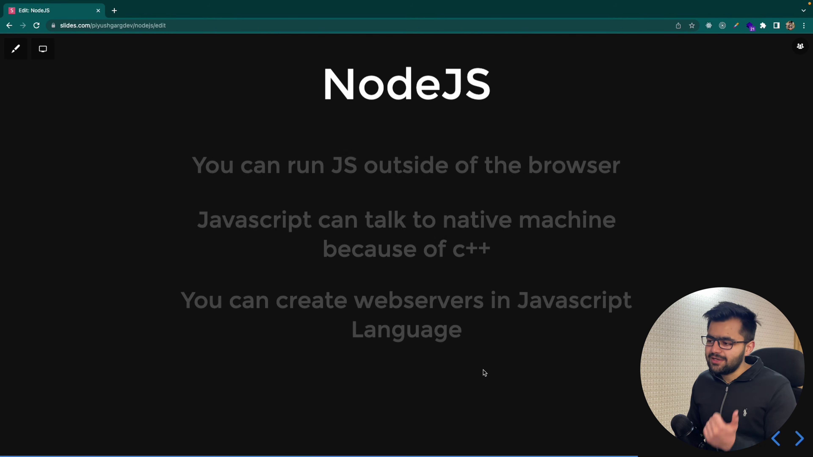

*Summary slide listing key capabilities provided by Node.js.*

### Key Takeaway

> By integrating Chrome's V8 engine with C++, Ryan Dahl enabled JavaScript to run outside the browser and perform host machine-level server operations.

## 3. Defining Node.js & Practical Demonstration `[04:39 - 06:25]`

### Explanation

Node.js is defined specifically as a JavaScript Runtime Environment—it is neither a programming language, nor a framework, nor a library. While browser developer consoles allow inline JavaScript execution, standard command-line shells (like zsh or bash) fail to recognize raw JavaScript statements natively. By launching the `node` command in the terminal, users start the interactive Node.js REPL (Read-Eval-Print Loop) environment, which parses and executes JavaScript directly on the operating system.

### Key Concepts

- JavaScript Runtime Environment
- Terminal Shell Execution
- Node.js Interactive REPL

### Examples

- Executing expressions (`console.log('Hello')`, `2+3`) in Chrome DevTools Console
- Failing to execute raw JS directly in terminal shell versus successfully running JS commands inside the `node` terminal shell REPL

### Visual Explanation

The video demonstrates running simple JavaScript code in the Chrome DevTools Console, followed by a OS Terminal session. In the terminal, raw JS initially throws a command syntax error until the user enters `node` (launching `Welcome to Node.js v16.14.2.`), allowing direct REPL code execution.

### Important Visual Text

- `What is NodeJS? NodeJS is a Runtime Env. for Javascript`
- `console.log('Hello')`
- `2+3`
- `zsh: unknown file attribute: H`
- `% node`
- `Welcome to Node.js v16.14.2.`
- `> console.log('Hello')`
- `> 2+5`

### Visuals

**Slide at 04:40**

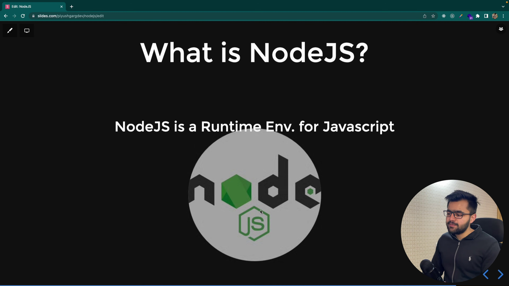

*Definition slide stating that Node.js is a runtime environment for JavaScript.*

**Demonstration at 05:01**

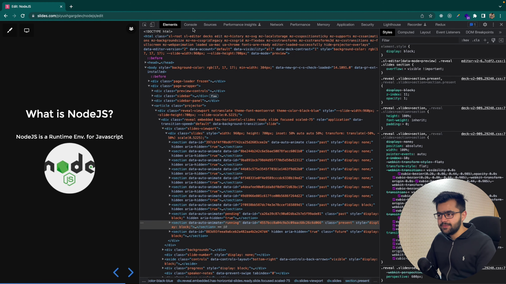

*Chrome DevTools Console showing JavaScript code execution (e.g., console.log and arithmetic).*

**Demonstration at 05:43**

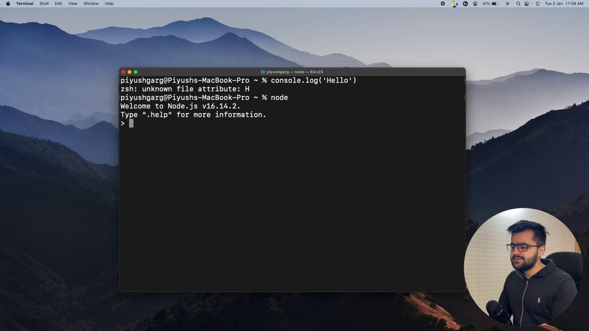

*Mac OS Terminal demonstrating an error when running raw JS code, followed by launching `node` to enter the Node.js interactive REPL.*

### Key Takeaway

> Node.js acts as an interactive runtime environment that allows developers to run JavaScript outside the browser via the terminal.

## 4. Official Node.js Definition & Prerequisites `[06:25 - 07:44]`

### Explanation

According to the official documentation on nodejs.org, 'Node.js is an open-source, cross-platform JavaScript runtime environment.' Because Node.js provides the environment to execute standard JavaScript code outside the browser, having a thorough understanding of core JavaScript fundamentals is a mandatory prerequisite before learning Node.js concepts or backend development.

### Key Concepts

- Open-source
- Cross-platform Runtime
- Core JavaScript Prerequisites

### Examples

- Consulting official documentation at nodejs.org
- Mastering fundamental JS concepts before building server-side applications

### Visual Explanation

A browser screenshot displays the official Node.js website (nodejs.org) featuring the highlighted formal definition text. This is followed by a slide showing recommended JavaScript prerequisite topics.

### Important Visual Text

- `Node.js® is an open-source, cross-platform JavaScript runtime environment.`
- `Ultimate Javascript Tutorials - Piyush Garg`

### Visuals

**Screenshot at 06:38**

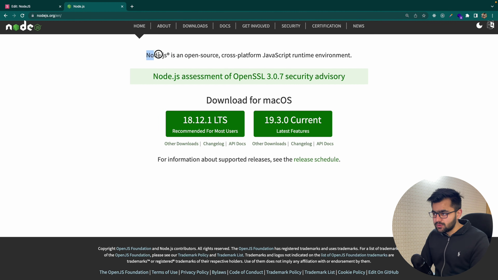

*Official Node.js website (nodejs.org) homepage highlighting the formal definition.*

**Screenshot at 07:02**

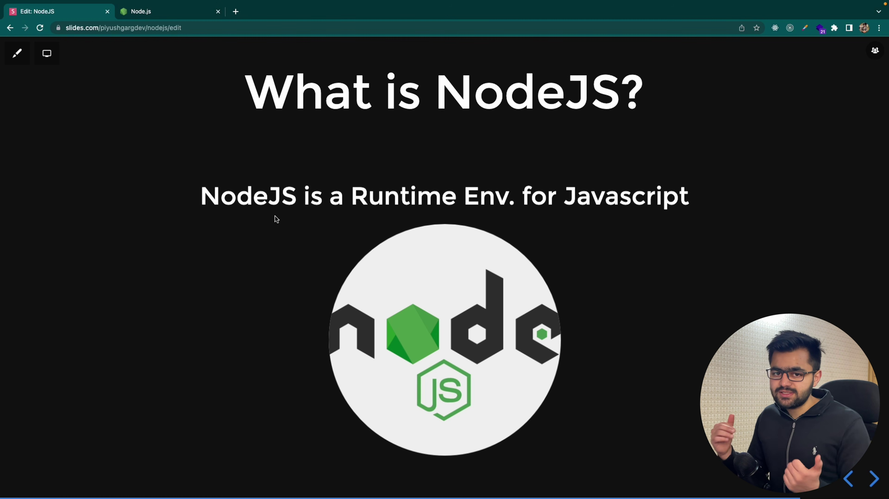

*YouTube playlist page for 'Ultimate Javascript Tutorials' recommending JS prerequisite topics.*

### Key Takeaway

> Node.js is an open-source, cross-platform runtime for running JavaScript, requiring strong foundational knowledge of core JavaScript.

## Final Takeaways

- Node.js is an open-source, cross-platform JavaScript runtime environment, not a language, framework, or library.
- Created by Ryan Dahl, Node.js combines Google Chrome's V8 engine with C++ to execute JavaScript outside of web browsers.
- Through C++ bindings, Node.js grants JavaScript access to host operating system features like filesystems and memory management.
- The `node` terminal command launches an interactive REPL shell for running JavaScript scripts locally.
- A solid background in core JavaScript programming is essential before learning Node.js.
