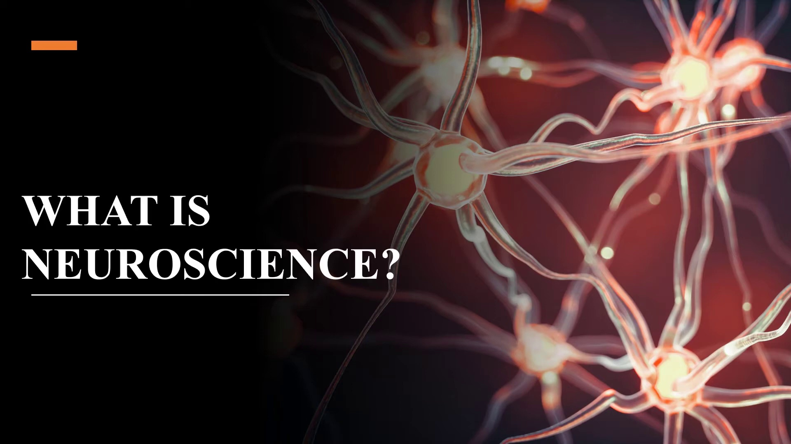
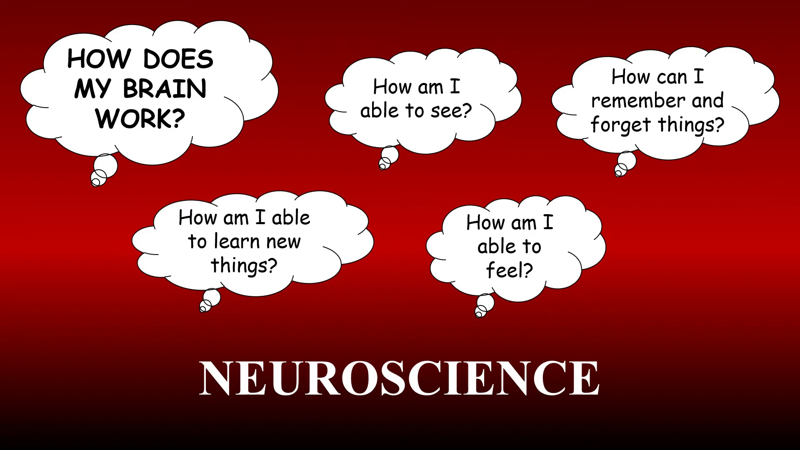
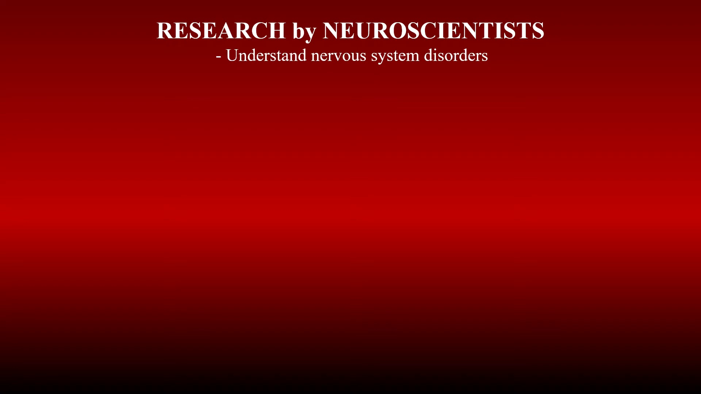
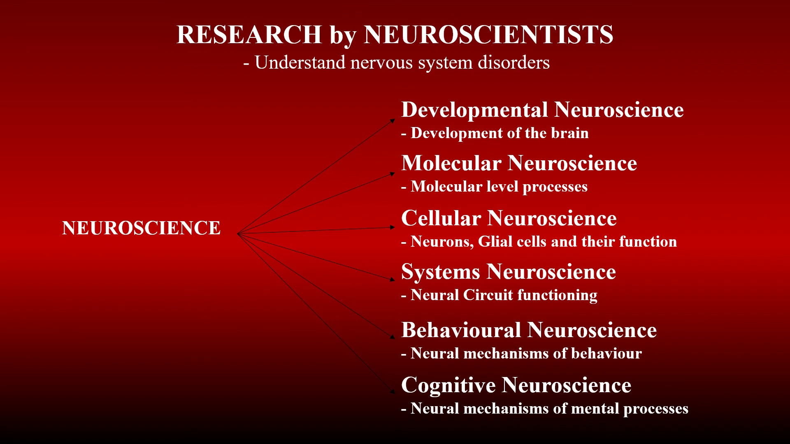

# Introduction to Neuroscience: Core Concepts and Major Subfields

## Overview

This lecture provides an introduction to neuroscience, defining it as the multidisciplinary study of the brain and nervous system. It outlines the clinical and scientific goals of neuroscientists in understanding nervous system disorders and breaks down the field into six fundamental subdisciplines: developmental, molecular, cellular, systems, behavioural, and cognitive neuroscience.

**Duration:** 02:20

## 1. Introduction to Neuroscience and Fundamental Questions `[00:00 - 00:33]`

### Explanation

Neuroscience is a centuries-old, multidisciplinary branch of science dedicated to deciphering the mechanics of the brain and nervous system. The discipline addresses core questions about how biological mechanisms translate into psychological and cognitive functions, specifically exploring how humans perceive external stimuli (vision, audition, somatosensation), acquire and store knowledge, recall or forget memories, and experience emotional states.

### Key Concepts

- Neuroscience
- Multidisciplinary science
- Sensory perception
- Memory formation and forgetting
- Emotional processing

### Examples

- Sensory perception, such as seeing and feeling external stimuli
- Cognitive processes, such as learning new skills and acquiring knowledge
- Memory dynamics, including encoding, retention, and forgetting

### Visual Explanation

The lecture opens with a title slide showing an illustration of interconnected neurons with glowing synaptic terminals. It then presents a mind map structured with thought bubbles surrounding the central label 'NEUROSCIENCE', visualizing fundamental inquiries regarding perception, learning, and memory formation.

### Important Visual Text

- `WHAT IS NEUROSCIENCE?`
- `HOW DOES MY BRAIN WORK?`
- `How am I able to learn new things?`
- `How am I able to see?`
- `How am I able to feel?`
- `How can I remember and forget things?`
- `NEUROSCIENCE`

### Visuals

**Slide at 00:05**

*Title slide introducing the topic over an illustration of interconnected neurons with glowing synaptic terminals.*

**Diagram at 00:27**

*A thought bubble mind map displaying various questions about brain function surrounding the central label NEUROSCIENCE.*

### Key Takeaway

> Neuroscience investigates how the biological structures of the brain and nervous system produce sensory perception, learning, memory, and emotions.

## 2. Role of Neuroscientists: Developmental and Molecular Neuroscience `[00:33 - 01:50]`

### Explanation

Neuroscientists study the structural and functional complexities of the brain with the vital medical objective of diagnosing, understanding, and treating nervous system disorders. Because of the brain's immense complexity, the discipline is organized into specialized branches. Developmental neuroscience examines the morphological and functional changes of the brain across the lifespan, including how it initially forms and grows. Molecular neuroscience operates at the biochemical level, focusing on the specific molecules, signaling pathways, and chemical processes essential to brain operation.

### Key Concepts

- Neuroscientists
- Nervous system disorders
- Developmental neuroscience
- Molecular neuroscience

### Examples

- Investigating the growth trajectories and structural changes of the brain during development
- Analyzing biochemical signaling pathways and molecular constituents within nervous tissue
- Developing diagnostic criteria and therapies for neurological conditions

### Visual Explanation

A slide outlines the primary clinical mission of neuroscientist research regarding nervous system disorders. This connects to a hierarchical branching diagram radiating outward from 'NEUROSCIENCE', illustrating developmental and molecular neuroscience as distinct research branches with brief definitions.

### Important Visual Text

- `RESEARCH by NEUROSCIENTISTS`
- `- Understand nervous system disorders`
- `NEUROSCIENCE`
- `Developmental Neuroscience - Development of the brain`
- `Molecular Neuroscience - Molecular level processes`

### Visuals

**Slide at 00:43**

*Slide outlining the research objectives of neuroscientists.*

**Diagram at 01:49**

*A branching diagram mapping branches of neuroscience stemming from the core term NEUROSCIENCE, highlighting developmental and molecular neuroscience.*

### Key Takeaway

> To address complex nervous system disorders, neuroscience divides brain research across specialized levels, beginning with developmental timelines and molecular processes.

## 3. Cellular, Systems, Behavioural, Cognitive Neuroscience, and Future Horizons `[01:50 - 02:20]`

### Explanation

The analysis of the brain scales up across cellular, circuit, and systemic tiers. Cellular neuroscience focuses on individual cells—both neurons and glial cells—and how their functions combine to establish neural circuits. Systems neuroscience examines how these neural circuits function collaboratively as integrated networks. Behavioural neuroscience investigates the underlying neural mechanisms that govern physical actions and behaviors. Cognitive neuroscience studies the neural substrates of higher-order mental processes, analyzing how brain activity gives rise to the mind and conscious thought. Finally, the lecture highlights that neuroscience remains in an active phase of discovery, as the brain's true complexity far exceeds current understanding.

### Key Concepts

- Cellular neuroscience
- Glial cells
- Neural circuits
- Systems neuroscience
- Behavioural neuroscience
- Cognitive neuroscience
- Cognition

### Examples

- Studying the physiological roles and interactions of neurons and glial cells
- Mapping circuit networks to understand coordinated systems-level activity
- Correlating specific neural pathways with behavioral patterns and motor outputs
- Investigating how neural firing patterns generate conscious mental processes and cognition

### Visual Explanation

A comprehensive tree diagram categorizes all six major neuroscience disciplines branching from 'NEUROSCIENCE', providing definitions for cellular, systems, behavioural, and cognitive subfields. The lecture concludes with a slide emphasizing the extensive scope of undiscovered knowledge in the field.

### Important Visual Text

- `Cellular Neuroscience - Neurons, Glial cells and their function`
- `Systems Neuroscience - Neural Circuit functioning`
- `Behavioural Neuroscience - Neural mechanisms of behaviour`
- `Cognitive Neuroscience - Neural mechanisms of mental processes`
- `There is more to research and more to learn!`

### Visuals

**Diagram at 02:19**

*A complete branch chart categorizing six core disciplines of neuroscience research with brief definitions.*

### Key Takeaway

> Neuroscience encompasses structural and functional levels from single cells and neural circuits to complex behavior and cognition, with significant frontiers still awaiting discovery.

## Final Takeaways

- Neuroscience is a multidisciplinary science addressing both fundamental questions of brain function and the diagnosis and treatment of nervous system disorders.
- Brain research is hierarchically organized across six key subdisciplines: developmental, molecular, cellular, systems, behavioural, and cognitive neuroscience.
- The subdisciplines bridge multiple scales of analysis, moving from individual molecules, neurons, and glia up to neural circuits, observable behavior, and complex mental processes.
- Given the profound complexity of the human brain, neuroscience is a rapidly evolving field with many fundamental discoveries yet to be made.
